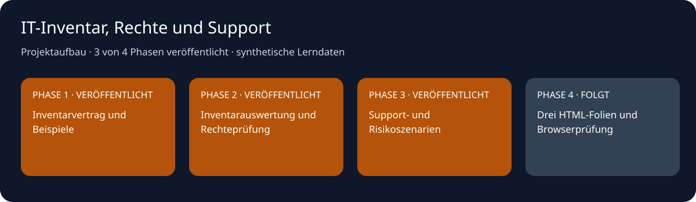

# IT-Inventar, Rechte und Support

Ein IT-Team möchte Geräte erfassen, zu weit gefasste Rechte erkennen und verständliche Support- und Risikoberichte erstellen.



**Veröffentlichungsstand: Phase 3/4.** Dieses eigenständige Repository übernimmt zunächst den bereits lokal committeten Stand. Weitere fachliche Phasen werden im Abstand von mindestens vier Stunden veröffentlicht. Die technische Entwicklung und die öffentliche Veröffentlichung haben unterschiedliche echte Zeitpunkte.

## Was hier zu sehen ist

| Schritt | Inhalt | Hier veröffentlicht |
|---|---|---|
| 1 | Inventarvertrag und Beispiele | Ja |
| 2 | Inventarauswertung und Rechteprüfung | Ja |
| 3 | Support- und Risikoszenarien | Ja |
| 4 | Drei HTML-Folien und Browserprüfung | Folgt |

## Fachlicher Nutzen

PowerShell-Datenverarbeitung, strukturierte Supportabläufe und begründete Risikobefunde.

## Lokal starten

Im geklonten Repository ausführen; die benötigte Laufzeit muss installiert sein. Python-Beispiele verwenden 3.12, Node-Beispiele 24 und C# die im Projekt angegebene .NET-Version. Befehle mit uv laden die dort genau bezeichneten Pakete bei Bedarf.

```powershell
powershell -NoProfile -File nachweise/P08-T03-pruefen.ps1
```

Ausführliche technische Befehle: [START.md](START.md). [Öffentlicher Prüfstand](ABNAHME.json) und [Quellphasen](VERLAUF.json) dokumentieren Herkunft und echte Ausführungsdaten. Eine neue Repositorykopie ist kein neuer nativer Desktoplauf.

## Ergebnis des lokal geprüften Schlussstands

Synthetisches Inventar und Rechte-/Risikoberichte; drei HTML-Folien tatsächlich im Browser geprüft.

**Dieser Schlussstand ist lokal bereits geprüft, aber noch nicht vollständig in diesem Repository veröffentlicht.** Maßgeblich für den hier verfügbaren Code ist die Phasentabelle oben.

## Grenzen

Keine echte AD-/Entra-Administration, NIS2-Zertifizierung oder PowerPoint-Datei.

Eigenes kleines Lernprojekt mit synthetischen Daten, mit KI-Unterstützung entwickelt und geprüft. Keine Aussage über Berufserfahrung, menschliche Arbeitsstunden oder praktische Verwendung weiterer nur geplanter Produkte.
